<p align="center">
  
</p>

# Contabilidad M4 Pro

**Gestión contable completa para despachos — en español, con dominio fiscal mexicano.**
Captura tus **Pólizas Contables** (ingreso, egreso, diario y cheque, con partida doble validada en vivo) y deja que la app derive solo el **Libro Diario**, las **Cuentas T**, el **Balance General** y el **Estado de Resultados**. Lleva **varios Clientes** a la vez —cada uno con su catálogo, activos, inventario, pólizas y RFC propio— y sincroniza tu contabilidad **Escritorio ↔ Móvil** con una bóveda personal encriptada de punta a punta.

> Versión: **v1.0.0 — primera versión pública** · Autor: Fernando Martínez · Licencia: Apache-2.0
>
> Disponible en **Windows · macOS · Linux · Android · Web/PWA** — un solo código base.

<p align="center">
  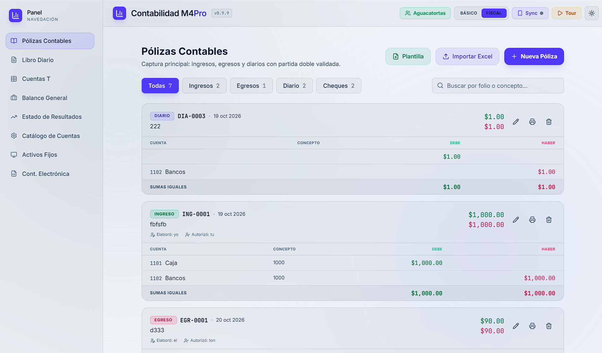
</p>

---

## ✨ Destacados

| | |
|---|---|
| 📒 **Partida doble en vivo** | El guardado se bloquea hasta que el Debe = Haber ("Sumas iguales"); imposible guardar un asiento descuadrado. |
| 🧾 **Formato papel mexicano** | Captura e impresión en hoja clásica (renglones, SUMAS IGUALES, Elaboró/Revisó/Autorizó), póliza diaria consolidada y hoja de cheque **con zona de calcado** para el papel carbón. |
| 👥 **Multi-cliente** | Cada cliente es un workspace aislado, con folios consecutivos por tipo dentro de cada uno. |
| 🛡️ **Bóveda E2EE** | Sincronización Escritorio ↔ Móvil con AES-GCM 256: el relay solo ve blobs ilegibles. Empareja con **QR** o **frase de respaldo de 6 palabras**. |
| 📄 **Restaurante SAT/Anexo 24** | **CT.xml, BN.xml, PL.xml y DIOT** a un clic, con folio real y soporte de CFDI por partida en Modo Fiscal. |
| 🎨 **4 temas de interfaz** | Oscuro, claro y dos de alto contraste; el switch es instantáneo y recuerda tu preferencia. |
| 🧭 **Tour guiado interactivo** | 29 pasos en español que recorren TODO el programa: al primer inicio y por el botón **Tour** del encabezado. |

---

## Índice

1. [Destacados](#-destacados)
2. [Capturas de pantalla](#-capturas-de-pantalla)
3. [Instalación desde el paquete publicado](#instalación-desde-el-paquete-publicado)
4. [Funcionalidades](#funcionalidades)
   - [Clientes (multi-cliente)](#1-clientes-multi-cliente)
   - [Pólizas contables](#2-pólizas-contables)
     - [Póliza de cheque con imagen](#-póliza-de-cheque-con-imagen)
     - [Importar desde Excel](#importar-desde-excel)
   - [Libro Diario (reporte e impresión)](#3-libro-diario-reporte-e-impresión)
   - [Cuentas T](#4-cuentas-t)
   - [Balance General](#5-balance-general)
   - [Estado de Resultados](#6-estado-de-resultados)
   - [Catálogo de Cuentas](#7-catálogo-de-cuentas)
   - [Activos Fijos (Modo Fiscal)](#8-activos-fijos-modo-fiscal)
   - [Contabilidad Electrónica SAT (Modo Fiscal)](#9-contabilidad-electrónica-sat-modo-fiscal)
   - [Bóveda E2EE (Escritorio ↔ Móvil)](#10-sincronización-escritorio--móvil-bóveda-e2ee)
   - [Tour guiado, temas y productividad](#11-tour-guiado-temas-y-productividad)
5. [Configuración del entorno local (desde cero)](#configuración-del-entorno-local-desde-cero)
6. [Scripts disponibles](#scripts-disponibles)
7. [Tecnologías utilizadas](#tecnologías-utilizadas)

---

## 📸 Capturas de pantalla

| | |
|:---:|:---:|
| **Libro Diario**<br>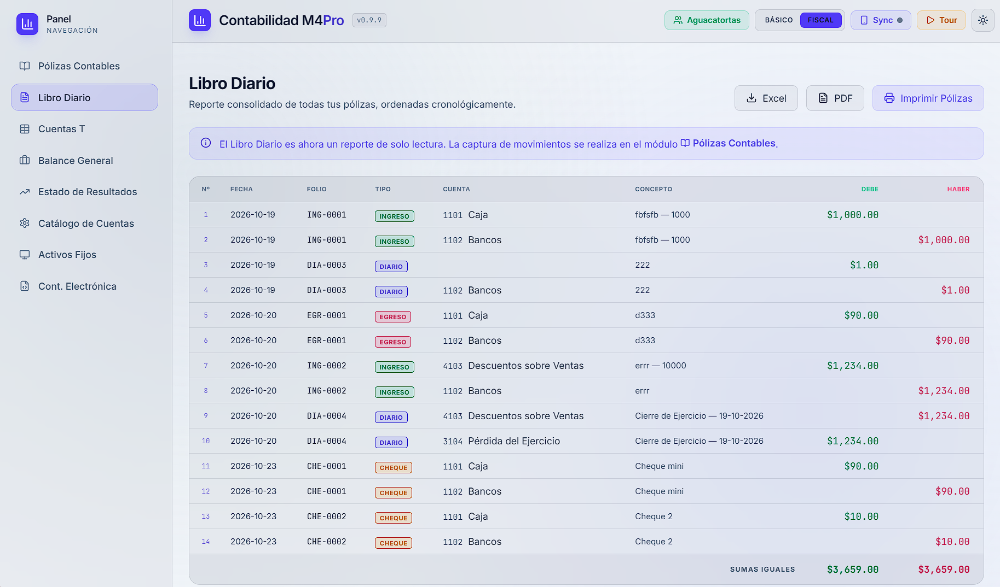 | **Cuentas T**<br>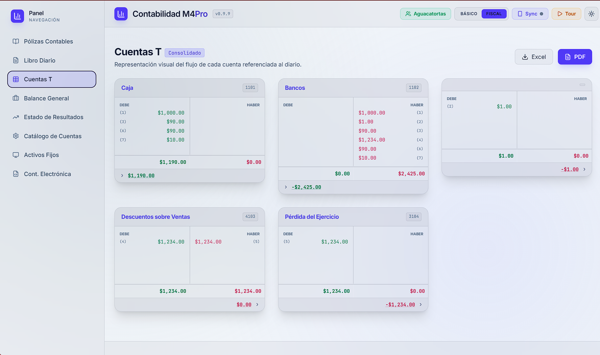 |
| **Balance General**<br>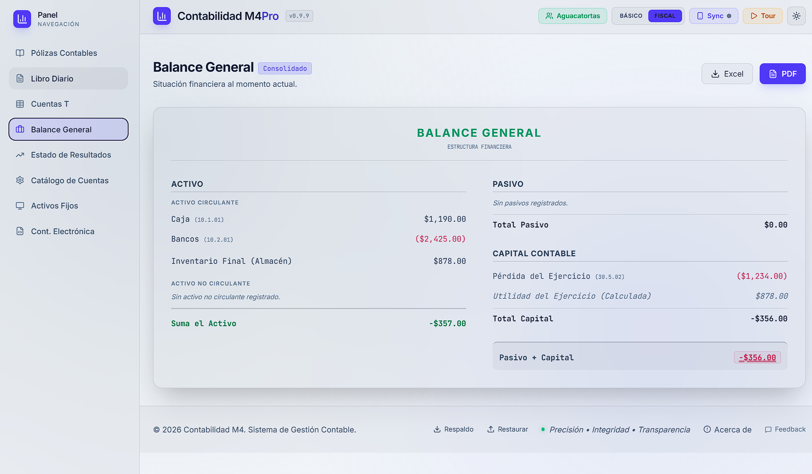 | **Estado de Resultados**<br>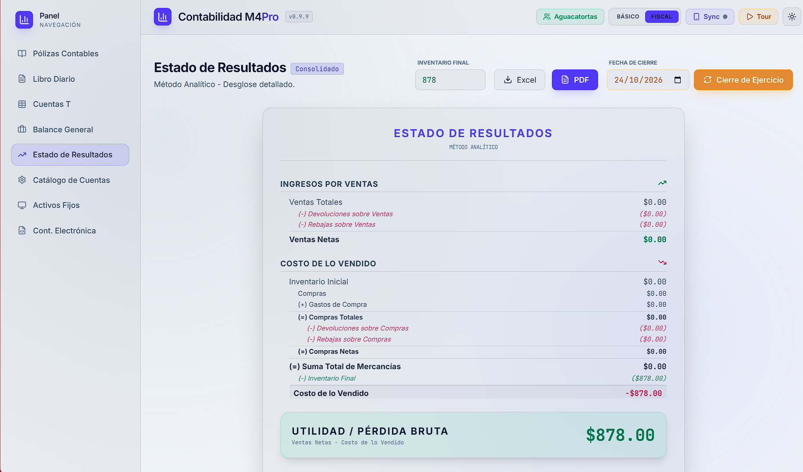 |
| **Catálogo de Cuentas**<br>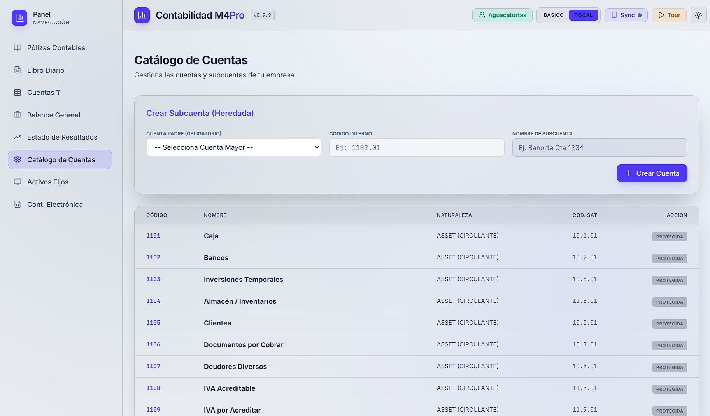 | **Activos Fijos (Modo Fiscal)**<br>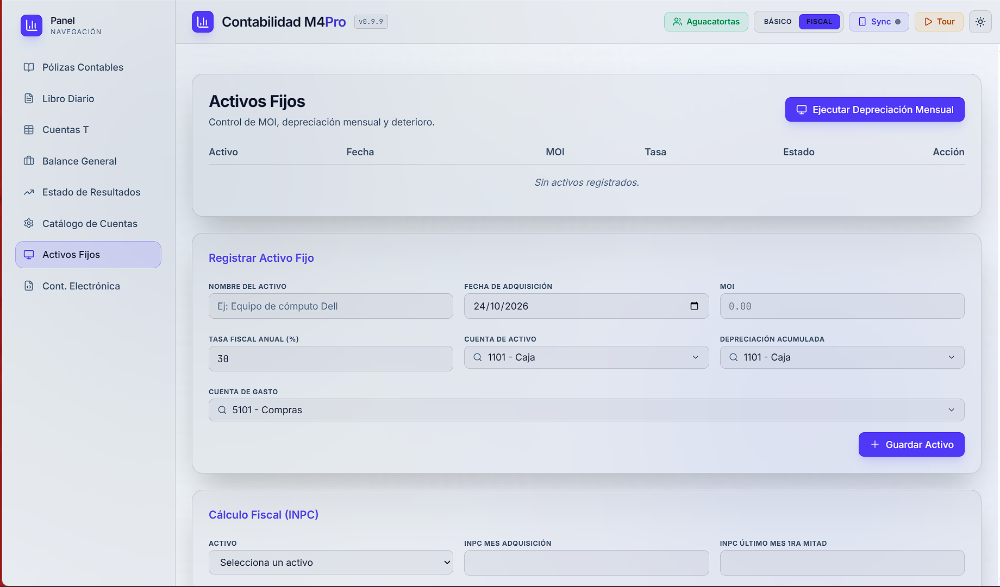 |
| **Contabilidad Electrónica SAT**<br>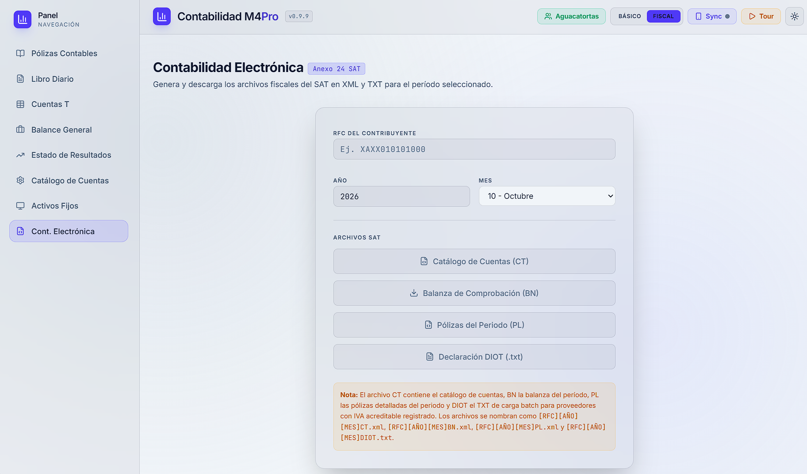 | **Sincronización con bóveda E2EE**<br>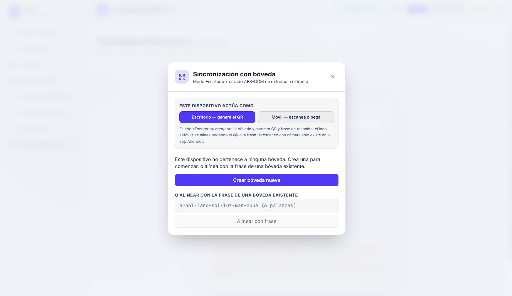 |
| **Temas de interfaz**<br>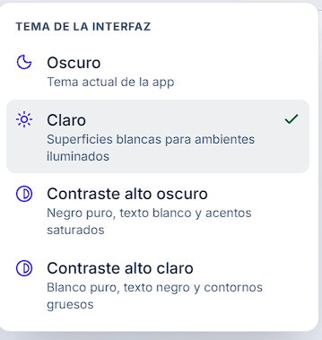 | **Gestor de Clientes**<br>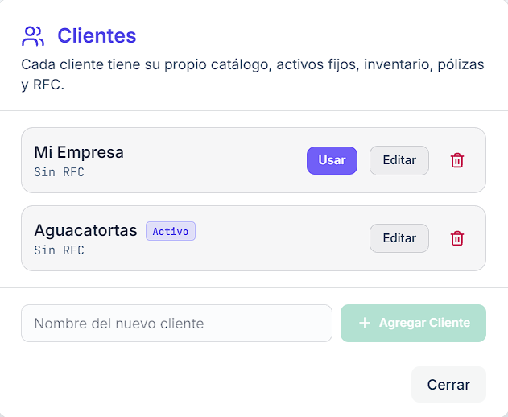 |

---

## Instalación desde el paquete publicado

Descarga el instalador correspondiente a tu sistema operativo desde la [página de Releases](https://github.com/MrDfour/Contabilidad-M4/releases/latest):

| Sistema operativo | Archivo a descargar              |
|-------------------|----------------------------------|
| Windows           | `Contabilidad-M4-Pro-Setup-*.exe` (instalador NSIS) |
| macOS             | `Contabilidad-M4-Pro-*.dmg`      |
| Linux             | `Contabilidad-M4-Pro-*.AppImage` |
| Android           | `app-*.apk`                      |

### Windows
1. Descarga el `.exe` y ejecútalo.
2. El asistente te permite elegir el directorio de instalación.
3. Al finalizar, abre la aplicación desde el acceso directo creado en el escritorio o en el menú Inicio.

### macOS
1. Descarga el `.dmg` y ábrelo.
2. Arrastra `Contabilidad M4 Pro` a la carpeta `Aplicaciones`.
3. La primera vez es posible que macOS te pida confirmar la apertura (clic derecho → Abrir).

### Linux
1. Descarga el `.AppImage`.
2. Dale permiso de ejecución: `chmod +x Contabilidad-M4-Pro-*.AppImage`
3. Ejecútalo con doble clic o desde la terminal: `./Contabilidad-M4-Pro-*.AppImage`

### Android
1. Descarga el `.apk` en tu dispositivo.
2. Activa la instalación desde fuentes desconocidas en los ajustes del sistema.
3. Abre el archivo `.apk` e instálalo.

### Web / PWA
La versión web se despliega en Cloudflare Pages: ábrela en tu navegador y, desde el menú del navegador, elige **"Instalar aplicación"**. Se comporta como una app (ventana propia) y **se actualiza sola** al reabrirla.

> **Nota:** Los datos se guardan localmente en el dispositivo (localStorage en escritorio/web, almacenamiento interno en Android; bóveda cifrada si usas la sincronización). No se requiere conexión a internet para trabajar.

---

## Funcionalidades

### 1. Clientes (multi-cliente)

Los contadores que atienden **varias empresas** alternan entre clientes desde el botón del encabezado (muestra el nombre del cliente activo). Todo lo que ves y capturas en la app pertenece **siempre al cliente activo**:

- Cada cliente tiene su propio **catálogo de cuentas, activos fijos, inventario final, pólizas y RFC**.
- Los **folios de póliza son consecutivos por tipo dentro de cada cliente** (el ING 1 de un cliente no interfiere con el de otro).
- El botón **"Clientes"** abre el gestor donde puedes:
  - **Cambiar de cliente** (botón "Usar"): la contabilidad del otro cliente se carga al instante.
  - **Agregar un cliente** nuevo (arranca con catálogo base readonly).
  - **Editar nombre y RFC** del cliente (el RFC se usa para los XML SAT y la DIOT).
  - **Eliminar un cliente** (con confirmación; siempre debe existir al menos uno).
- Los **respaldos incluyen a todos tus clientes**; al restaurar un respaldo viejo de versión anterior, sus datos se aplican al **cliente activo**.

<p align="center">
  
</p>

### 2. Pólizas contables

Las **Pólizas Contables** son la unidad de captura principal de la aplicación (pestaña por defecto). Cada póliza es un asiento formal con partida doble validada, tipo de póliza SAT y folio consecutivo por tipo dentro del cliente activo.

<p align="center">
  
</p>

#### Crear una póliza
1. Haz clic en **"Nueva Póliza"** (esquina superior derecha del módulo).
2. Completa los campos:
   - **Formato** – elige la hoja: Ingreso (1), Egreso (2), Diario (3) o **Cheque** según el Anexo 24 del SAT (el cheque se exporta a SAT como egreso, tipo 2). El folio se asigna automáticamente y es **consecutivo por tipo** (ING 1, 2, 3… / EGR 1, 2, 3… / DIA 1, 2, 3… / CHE 1, 2, 3…). La captura abre en **formato papel** (hoja imprimible); el enlace "usar captura clásica (campos)" cambia al modo de columnas.
   - **Fecha** y **Concepto** de la operación.
   - **Partidas** – cada fila es un lado del asiento: cuenta, cargo (Debe) o abono (Haber), monto y concepto opcional.
3. La **partida doble se valida en vivo**: el guardado solo se habilita cuando las sumas del Debe y del Haber coinciden ("Sumas iguales") y hay al menos 2 partidas.
4. En **Modo Fiscal** cada partida admite **CFDI**: UUID leído directo de un XML (botón "Leer CFDI") y RFC del tercero, usados por el XML SAT de Pólizas y la DIOT.

#### 🧾 Póliza de cheque con imagen

Además del asiento contable, la póliza de cheque lleva sus **datos propios**: Nº de cheque (el folio bancario, distinto del folio contable CHE), Banco y Beneficiario.

- **Imagen del cheque**: puedes adjuntar una foto/escaneo al crear la póliza; la app la comprime automáticamente para que pese poco (objetivo ~150 KB) sin perder legibilidad. La imagen se ve como **miniatura en la tarjeta** (clic la agranda).
- **La imagen vive solo en tu equipo**: no viaja por la sincronización ni en los respaldos (esos llevan sus metadatos: peso, fecha y huella). En otro dispositivo verás el aviso *"solo en su equipo"* en lugar de la foto.
- **Limpieza automática**: si guardaste una imagen y la póliza no llegó a crearse, la app te avisa durante un día para que la rescates (descargarla a tu dispositivo) o la descartes; al quinto día se borra sola.
- **Impresión**: el botón Imprimir saca la **hoja de póliza de cheque** con espacio en blanco para calcar la imagen a mano, los datos del cheque y una línea de firma de recibido. Opcionalmente, la casilla **"Con imagen del cheque"** (default apagada) imprime la imagen anexa DENTRO de la zona de calcado en lugar del blanco — útil como comprobante de la imagen digital; si el equipo no tiene la imagen, la zona simplemente queda en blanco. La preferencia se comparte entre el diario ("Hoja por póliza") y la impresión individual.

#### Filtrado y búsqueda
- Chips **Todas / Ingresos / Egresos / Diario / Cheques** con conteo por tipo.
- Buscador por folio numérico o concepto.
- Las pólizas se listan con su folio formateado (ej. `ING 0005`), desglose de partidas y las sumas del Debe/Haber.

#### Editar y eliminar
- El lápiz de la tarjeta reabre el formulario precargado (el **tipo queda congelado** en edición; el folio se conserva).
- La papelera pide confirmación antes de eliminar.

#### Imprimir formato físico
- Botón "Imprimir" → hoja imprimible según el tipo (póliza de cheque con su hoja propia) con distintivo del tipo, desglose de partidas, sumas iguales y renglones de firma **Elaboró / Revisó / Autorizó** (quedan en blanco para firmar a mano).

#### Importar desde Excel
¿Vienes de COI, CONTPAQi u otro sistema? Migra catálogo y pólizas sin capturarlas otra vez:

1. Descarga la **Plantilla** para conocer el formato. Las columnas son:

   | Columna       | Descripción                                              |
   |---------------|----------------------------------------------------------|
   | `ASIENTO_ID`  | Número de asiento (agrupa las filas de la misma póliza)  |
   | `FECHA`       | Fecha en formato `YYYY-MM-DD`                            |
   | `GLOSA`       | Concepto / descripción de la póliza                      |
   | `CUENTA`      | Nombre exacto de la cuenta (según el catálogo integrado) |
   | `DEBE`        | Monto en el Debe (0 si no aplica)                        |
   | `HABER`       | Monto en el Haber (0 si no aplica)                       |

2. Haz clic en **"Importar"** y selecciona tu archivo `.xlsx` (tolera montos con `$` y comas, fechas de Excel y celdas vacías que heredan del asiento anterior).
3. La app agrupa las filas por `ASIENTO_ID` y crea pólizas de tipo **Diario** con folios nuevos; si alguna cuenta no se reconoce, el aviso de éxito **te lista qué cuentas fueron omitidas** para que las completes en el catálogo y reimportes esas filas.

### 3. Libro Diario (reporte e impresión)

El Libro Diario ya no captura movimientos: es un **reporte consolidado de solo lectura** que refleja todas las pólizas ordenadas cronológicamente (fecha + folio).

- Tabla clara **FECHA / FOLIO / TIPO / CUENTA / CONCEPTO / DEBE / HABER**, con las sumas iguales al final.
- Exportación a **Excel** y **PDF** (`Libro_Diario_Consolidado`) con cabecera y firmas.
- **Impresión en papel por día o rango** de fechas (con presets "Hoy" y "Este mes") en 3 formatos: **hoja por póliza**, **póliza diaria consolidada** (todas las pólizas del día agregan sus importes por cuenta en un solo renglón) o **libro continuo**.
- **Toggle "Incluir cheques"**: decide si las pólizas de cheque entran al libro impreso completo (encendido por defecto). Con él apagado, el aviso te dice cuántos cheques se excluyeron.

<p align="center">
  
</p>

### 4. Cuentas T

Las Cuentas T se calculan automáticamente a partir de la **proyección consolidada de las pólizas** (ordenadas fecha + folio); no requieren entrada manual.

- Cada cuenta usada en al menos una póliza se muestra como una "T" clásica con:
  - **Columna izquierda (Debe):** movimientos con número de referencia (posición en la proyección consolidada, 1-index).
  - **Columna derecha (Haber):** movimientos con número de referencia.
  - **Fila de totales:** suma del Debe y suma del Haber.
  - **Saldo:** el saldo normal de la cuenta (deudor o acreedor) resaltado.
- **Exportar a Excel** → genera un archivo `.xlsx` con las cuentas T dibujadas en formato tabular (4 cuentas por fila), incluyendo totales y saldo final.
- **Exportar a PDF** → genera un PDF con todas las cuentas T en formato visual.

<p align="center">
  
</p>

### 5. Balance General

El Balance General se genera automáticamente a partir de los saldos calculados por las Cuentas T.

Estructura:
- **Activo** – Activo Circulante y Activo No Circulante.
- **Pasivo** – Pasivo a Corto Plazo y Pasivo a Largo Plazo.
- **Capital Contable** – Capital Social, reservas y resultados.

Solo aparecen las cuentas con saldo distinto de cero. Se verifica automáticamente:
- Total Activo = Total Pasivo + Capital.

Exportación:
- **PDF** → Balance presentado en columnas (Activo | Pasivo + Capital), con encabezado y firmas.
- **Excel** → Datos en formato tabular.

<p align="center">
  
</p>

### 6. Estado de Resultados

Presenta el resultado del ejercicio usando el **Método Analítico** (desglosado).

Secciones calculadas automáticamente:
1. **Ingresos por Ventas**
   - Ventas Totales
   - (−) Devoluciones sobre Ventas
   - (−) Rebajas/Descuentos sobre Ventas
   - = **Ventas Netas**
2. **Costo de lo Vendido**
   - Inventario Inicial
   - (+) Compras + Gastos de Compra = Compras Totales
   - (−) Devoluciones sobre Compras
   - (−) Descuentos sobre Compras
   - = Compras Netas → Suma de Mercancías
   - (−) **Inventario Final** *(valor ingresado manualmente)*
   - = **Costo de lo Vendido**
3. **Utilidad Bruta** = Ventas Netas − Costo de lo Vendido
4. **Gastos Operativos** (Gastos de Venta, Gastos de Administración, Gastos Financieros, Otros Gastos)
5. **Utilidad / Pérdida Neta**

> El **Inventario Final** debe ingresarse manualmente en el campo correspondiente; su valor se guarda automáticamente.

Exportación:
- **PDF** → Estado de resultados completo con encabezado, desglose y firmas.
- **Excel** → Tabla con todos los conceptos y montos.

<p align="center">
  
</p>

### 7. Catálogo de Cuentas

La aplicación incluye un catálogo preconfigurado de cuentas contables en español, organizado por tipo y con códigos contables listos para trabajar (las cuentas base son readonly; puedes agregar las tuyas):

| Código  | Cuenta                              | Tipo      |
|---------|-------------------------------------|-----------|
| **Activo Circulante** |||
| 1101    | Caja                                | Activo    |
| 1102    | Bancos                              | Activo    |
| 1103    | Inversiones Temporales              | Activo    |
| 1104    | Almacén / Inventarios               | Activo    |
| 1105    | Clientes                            | Activo    |
| 1106    | Documentos por Cobrar               | Activo    |
| 1107    | Deudores Diversos                   | Activo    |
| 1108    | IVA Acreditable                     | Activo    |
| 1109    | IVA por Acreditar                   | Activo    |
| 1110    | Anticipo a Proveedores              | Activo    |
| **Activo No Circulante** |||
| 1201    | Terrenos                            | Activo    |
| 1202    | Edificios                           | Activo    |
| 1203    | Mobiliario y Equipo de Oficina      | Activo    |
| 1204    | Equipo de Cómputo                   | Activo    |
| 1205    | Equipo de Entrega o Reparto         | Activo    |
| 1206    | Depósitos en Garantía               | Activo    |
| 1207    | Gastos de Instalación               | Activo    |
| 1208    | Gastos de Organización              | Activo    |
| 1209    | Propaganda y Publicidad             | Activo    |
| 1210    | Primas de Seguros                   | Activo    |
| 1211    | Rentas Pagadas por Anticipado       | Activo    |
| 1212    | Intereses Pagados por Anticipado    | Activo    |
| **Pasivo a Corto Plazo** |||
| 2101    | Proveedores                         | Pasivo    |
| 2102    | Documentos por Pagar                | Pasivo    |
| 2103    | Acreedores Diversos                 | Pasivo    |
| 2104    | IVA Trasladado                      | Pasivo    |
| 2105    | IVA por Trasladar                   | Pasivo    |
| 2106    | Impuestos y Cuotas por Pagar        | Pasivo    |
| 2107    | Anticipo de Clientes                | Pasivo    |
| 2108    | Sueldos por Pagar                   | Pasivo    |
| **Pasivo a Largo Plazo** |||
| 2201    | Hipotecas por Pagar / Acreedores Hipotecarios | Pasivo |
| 2202    | Documentos por Pagar a Largo Plazo  | Pasivo    |
| 2203    | Rentas Cobradas por Anticipado      | Pasivo    |
| 2204    | Intereses Cobrados por Anticipado   | Pasivo    |
| **Capital Contable** |||
| 3101    | Capital Social                      | Capital   |
| 3102    | Reserva Legal                       | Capital   |
| 3103    | Utilidad del Ejercicio              | Capital   |
| 3104    | Pérdida del Ejercicio               | Capital   |
| 3105    | Utilidades Acumuladas / Retenidas   | Capital   |
| 3106    | Pérdidas Acumuladas                 | Capital   |
| **Ingresos** |||
| 4101    | Ventas                              | Ingreso   |
| 4102    | Devoluciones sobre Ventas           | Ingreso   |
| 4103    | Descuentos sobre Ventas             | Ingreso   |
| 4104    | Productos Financieros               | Ingreso   |
| 4105    | Otros Productos                     | Ingreso   |
| **Costos y Gastos** |||
| 5101    | Compras                             | Gasto     |
| 5102    | Gastos de Compra                    | Gasto     |
| 5103    | Devoluciones sobre Compras          | Gasto     |
| 5104    | Descuentos sobre Compras            | Gasto     |
| 5105    | Inventario Inicial                  | Gasto     |
| 5106    | Inventario Final                    | Gasto     |
| 5107    | Costo de Ventas                     | Gasto     |
| 5108    | Gastos de Venta                     | Gasto     |
| 5109    | Gastos de Administración            | Gasto     |
| 5110    | Gastos Financieros                  | Gasto     |
| 5111    | Otros Gastos                        | Gasto     |
| 5112    | Gasto por Depreciación              | Gasto     |
| 5113    | Pérdida por Deterioro               | Gasto     |

> Al importar asientos desde Excel, los nombres de cuenta deben coincidir con los del catálogo (mayúsculas/minúsculas se ignoran, pero conviene mantener tildes y nombres tal como aparecen para evitar rechazos).

<p align="center">
  
</p>

### 8. Activos Fijos (Modo Fiscal)

Cuando activas el **Modo Fiscal**, aparece el módulo de Activos Fijos para llevar mejor el control de inversiones:

- Registro de activos con **nombre, fecha de adquisición, MOI y tasa fiscal anual**.
- Marcado de activos **en operación** o **dados de baja**.
- Ejecución de **depreciación mensual** con generación automática de una **póliza de Diario** (cargo a gasto y abono a depreciación acumulada).
- Cálculo fiscal de **deducción de inversiones actualizada por INPC** para apoyo en análisis fiscal.

<p align="center">
  
</p>

### 9. Contabilidad Electrónica SAT (Modo Fiscal)

El módulo de **Contabilidad Electrónica** facilita entregables fiscales del Anexo 24:

- Generación de **Catálogo SAT (CT.xml)**, **Balanza (BN.xml)** y **Pólizas del Periodo (PL.xml)**.
- **RFC por cliente:** el campo del RFC se precarga con el RFC del cliente activo y, tras exportar, queda guardado en el cliente para las siguientes entregas.
- El XML de Pólizas se construye directamente desde tus pólizas del periodo: **folio real en `NumUnIdenPol`**, tipo SAT (1/2/3), concepto por partida y soporte de CompNal por CFDI.
- Generación de **DIOT (.txt)** con base en movimientos de IVA acreditable por RFC.
- Validación básica de formato de RFC y nomenclatura de archivos para descarga.

<p align="center">
  
</p>

### 10. Sincronización Escritorio ↔ Móvil (bóveda E2EE)

La app sincroniza datos entre dispositivos con una **bóveda personal encriptada de punta a punta** sobre un relay propio en Cloudflare (detalle técnico vivo en `ARCHITECTURE.md` §6):

- **Relay propio en Cloudflare Workers + KV** (sin costo en el plan gratuito) con WebSocket en vivo y degradación a sondeo.
- **Cifrado extremo a extremo (AES-GCM 256)**: el relay solo ve blobs ilegibles; las claves nacen en tu dispositivo.
- **Alistamiento**: el escritorio crea la bóveda y comparte la credencial con la app móvil mediante **QR** o **frase mnemónica determinista de 6 palabras** (la frase genera la misma bóveda en cualquier dispositivo; guárdala EN PAPEL). **En la versión web puedes elegir el rol de cada dispositivo** (Escritorio o Móvil); en los instaladores nativos el rol es fijo.
- **Auto-sync completo multi-cliente**: la bóveda transporta un respaldo v3 de TODAS las empresas; restaurar remoto reusa exactamente el camino de "Restaurar respaldo". **Las imágenes de cheques NO viajan** (el respaldo/bóveda lleva sus metadatos: peso, fecha y huella; la foto vive solo en el equipo original).
- **Debounce de publicación (1.5 s) + coalescing (120 s)** para respetar la cuota gratuita de KV; "Publicar ahora" fuerza el envío.
- **Regla de conflicto** ("manos sucias"): si solo un lado cambió, se aplica automáticamente; si ambos cambiaron, eliges **Conservar datos locales**, **Sobrescribir con datos remotos** o **Fusionar ambos**. La fusión muestra una **revisión previa** (resumen, folios en disputa, duplicados) y aplica lo que tú decidas; si a los entrantes les dejó folio "PENDIENTE", el módulo de Pólizas ofrece la acción **"Asignar pendientes"** para cerrarlos a mano. La versión ganadora queda vigente en todos los dispositivos.
- **Historial** (máximo 5 estados) con TTL de 30 días, consultable desde el modal — y pueden restaurarse — como metadatos de versión, fecha y dispositivo.
- Indicador de estado en el encabezado (gris / verde / naranja / rojo).

**Despliegue del relay** (una sola vez): ver [worker/README.md](worker/README.md).

<p align="center">
  
</p>

### 11. Tour guiado, temas y productividad

- **Tour guiado interactivo**: al primer arranque la app ofrece un recorrido de 29 pasos en español que muestra TODAS las funciones (captura, plantilla/importación, reportes, fiscal/CFDI, activos fijos, bóveda —que se abre en vivo durante el paso de respaldo— y respaldo JSON). Puedes reabrirlo a voluntad con el botón **Tour** del encabezado; si lo saltas con «Saltarlo», no vuelve a abrirse por su cuenta. **Nunca escribe datos**: al final te ofrece borrar el cliente de demostración SOLO si es que solo existe ese cliente.
- **Temas de interfaz**: claro, oscuro y dos variantes de alto contraste — accesibles y sin afectar los impresos (las hojas imprimibles mantienen su tinta neutra a propósito).

<p align="center">
  
</p>
- **Verificador de actualizaciones** por plataforma: Electron con `electron-updater`; Android con actualización in-app (descarga del APK con progreso e instalación directa); la PWA se refresca sóla al reabrir.
- **Feedback integrado** desde la app para reportar sugerencias o errores.
- **Vigía de respaldo**: la app te avisa si llevas más de una semana sin respaldar.

---

## Configuración del entorno local (desde cero)

### Requisitos previos

| Herramienta | Versión mínima recomendada |
|-------------|---------------------------|
| [Node.js](https://nodejs.org/) | v20 o superior (el proyecto se desarrolla con la rama v26) |
| npm         | v10 o superior (incluido con Node.js) |

Verifica tu instalación:

```bash
node -v
npm -v
```

### 1. Clonar el repositorio

```bash
git clone https://github.com/MrDfour/Contabilidad-M4.git
cd Contabilidad-M4
```

### 2. Instalar dependencias

```bash
npm install
```

Esto descargará todas las dependencias definidas en `package.json`, incluyendo React, Vite, Tailwind CSS, Electron, ExcelJS, jsPDF y Capacitor.

### 3. Ejecutar en modo desarrollo (navegador)

```bash
npm run dev
```

Abre [http://localhost:3000](http://localhost:3000) en tu navegador. La aplicación se recargará automáticamente al guardar cambios en el código.

### 4. Compilar para producción (web estática)

```bash
npm run build
```

Los archivos compilados se generan en la carpeta `dist/` (incluye el manifest de PWA). Puedes servirlos con cualquier servidor web estático.

Para previsualizar la build localmente:

```bash
npm run preview
```

### 5. Compilar la aplicación de escritorio (Electron)

```bash
npm run electron:build
```

Esto primero ejecuta `vite build` y luego `electron-builder`, generando los instaladores en la carpeta `release/`:

- Windows → `release/Contabilidad M4 Pro Setup *.exe`
- macOS → `release/Contabilidad M4 Pro-*.dmg`
- Linux → `release/Contabilidad M4 Pro-*.AppImage`

> Para compilar para un sistema operativo específico desde línea de comandos consulta la [documentación de electron-builder](https://www.electron.build/cli).

### 6. Verificar tipos y correr pruebas

```bash
npm run lint   # tsc --noEmit: detecta errores de tipos sin generar archivos
npm run test   # Vitest: 38 archivos / 413 pruebas (una pasada)
```

> Para desarrollo del codebase, el mapa completo del proyecto vive en [`ARCHITECTURE.md`](ARCHITECTURE.md).

### Estructura del proyecto

```
Contabilidad-M4/
├── electron/
│   └── main.js          # Punto de entrada de Electron (ventana, IPC persistencia, auto-update)
├── src/
│   ├── App.tsx          # Orquestador principal (hooks de dominio + navegación + modales)
│   ├── types.ts         # Tipos TypeScript y catálogo de cuentas inicial
│   ├── components/      # Vistas: polizas/, account/, layout/, modals/, tour/ y reportes
│   ├── hooks/           # Dominios de estado (usePolizas, useCatalog, useBackup...)
│   ├── lib/             # Cálculo contable, formatos, migraciones, bóveda, exportaciones SAT/Excel/PDF
│   ├── services/        # storageService, attachmentService, vaultService, vaultSyncEngine, appUpdater
│   ├── main.tsx         # Punto de entrada de React
│   └── index.css        # Estilos globales (Tailwind v4 + temas)
├── android/             # Proyecto Capacitor (AppUpdater nativo in-app)
├── worker/              # Relay de la bóveda (Cloudflare Workers + KV)
├── vite.config.ts       # Configuración de Vite + PWA
├── tsconfig.json        # Configuración de TypeScript
└── package.json         # Dependencias y scripts (incl. electron-builder)
```

### Persistencia de datos

Los datos se almacenan localmente. Con multi-cliente, los datos de cada cliente viven en claves con **sufijo** (`contasis_<dominio>_<empresaId>`):

- `contasis_empresas` – lista de clientes y cuál está activo.
- `contasis_polizas_<id>` – pólizas del cliente (la clave sin sufijo quedó como histórico tras la migración).
- `contasis_accounts_<id>` – catálogo de cuentas del cliente (base readonly + propias).
- `contasis_final_inventories_<id>` – mapa `{ general: inventarioFinal }` del cliente.
- `contasis_fixed_assets_<id>` – activos fijos del cliente.
- `contasis_anexos_<id>` – registro de metadatos de las imágenes de cheques (peso, fecha y huella; **la imagen en sí** vive aparte en el almacenamiento local del dispositivo: IndexedDB en web, archivos internos en Android/Escritorio).
- `contasis_tema` – tema de interfaz elegido.
- `contasis_tour_state` / `contasis_tour_skipped` / `contasis_tour_demo_seedado` – estado del tour guiado.
- `contasis_vault_creds` – credenciales de la bóveda de sincronización (este dispositivo).
- `contasis_journals` – histórico de diarios legacy (si venías de una versión anterior; solo lectura, no se elimina desde la app).
- Claves sin sufijo (`contasis_polizas`, `contasis_accounts`, etc.) – archivo histórico de tu contabilidad previa a clientes; la migración las copió al primer cliente y no se vuelven a usar.

Para limpiar todos los datos, abre las herramientas de desarrollo (F12) → Application → Local Storage → elimina las claves mencionadas.

---

## Scripts disponibles

| Comando                  | Descripción                                                  |
|--------------------------|--------------------------------------------------------------|
| `npm run dev`            | Inicia el servidor de desarrollo en `localhost:3000`         |
| `npm run build`          | Compila la aplicación web para producción (`dist/` + PWA)    |
| `npm run preview`        | Previsualiza la build de producción localmente               |
| `npm run clean`          | Elimina la carpeta `dist/`                                   |
| `npm run lint`           | Verifica tipos TypeScript sin generar archivos               |
| `npm run test`           | Ejecuta la red de pruebas (Vitest, 413 pruebas, una pasada)  |
| `npm run test:watch`     | Modo vigilante de pruebas (se re-ejecutan al guardar)        |
| `npm run electron:build` | Compila la app de escritorio Electron para distribución      |

---

## Tecnologías utilizadas

| Librería / Herramienta   | Uso principal                                    |
|--------------------------|--------------------------------------------------|
| React 19                 | Interfaz de usuario                              |
| TypeScript               | Tipado estático (strict)                         |
| Vitest + Testing Library | Red de pruebas (413 pruebas colocadas junto al código) |
| Vite                     | Bundler y servidor de desarrollo                 |
| vite-plugin-pwa          | Manifest + service worker de la app web instalable |
| Tailwind CSS v4          | Estilos utilitarios y temas                      |
| Electron + electron-builder | Aplicación de escritorio multiplataforma      |
| Capacitor                | Empaquetado para Android                         |
| QRCode.react + @capacitor-mlkit | Emparejamiento y escaneo de QR (bóveda)  |
| Web Crypto (AES-GCM)     | Cifrado E2EE de la bóveda                        |
| Cloudflare Workers + KV  | Relay de sincronización (worker/)                |
| ExcelJS                  | Generación de archivos Excel con estilos         |
| xlsx                     | Lectura de archivos para importación             |
| jsPDF + jspdf-autotable  | Generación de documentos PDF                     |
| html2canvas-pro          | Captura de elementos HTML para PDF               |
| Motion (Framer Motion)   | Animaciones de UI                                |
| Lucide React             | Iconografía                                      |

---

© 2026 Contabilidad M4 · Fernando Martínez. Sistema de Gestión Contable.
